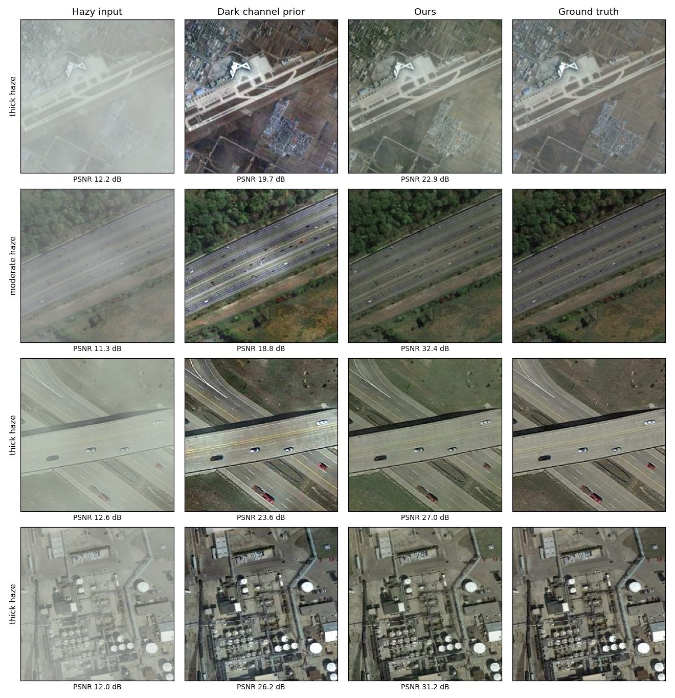
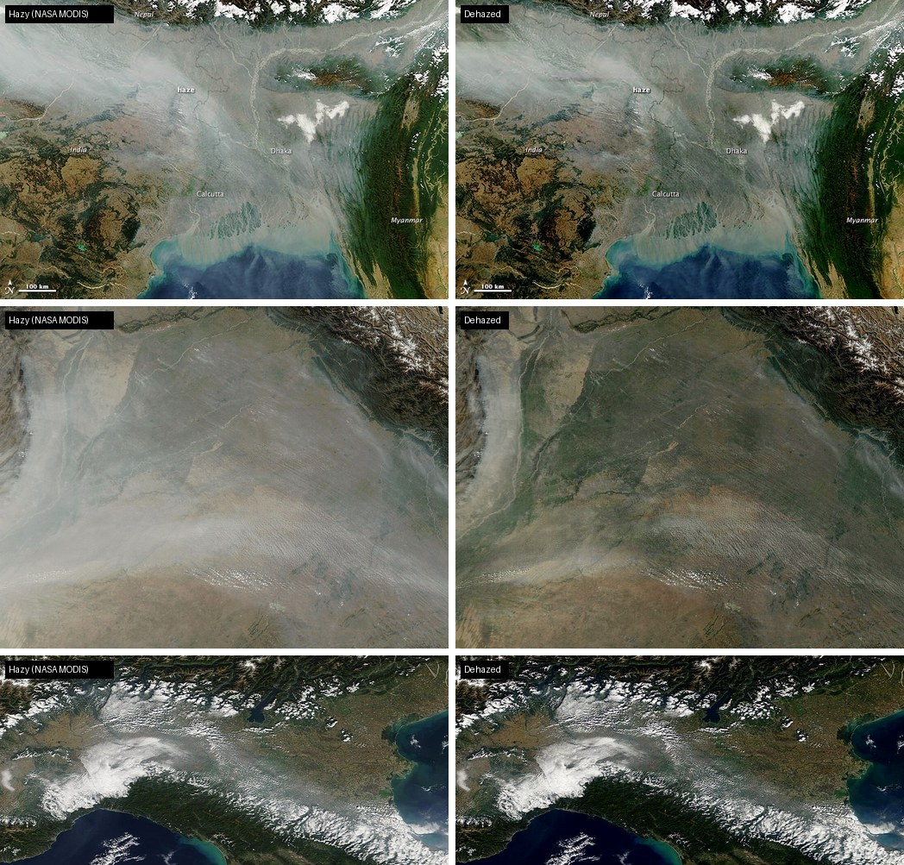

# Satellite Image Dehazing with Deep Learning

**Live demo: [harsh-satellite-dehazing.vercel.app](https://harsh-satellite-dehazing.vercel.app)**. Try it on real NASA images; everything runs in your browser.

An encoder-decoder (U-Net style) CNN that restores visibility in hazy satellite images. It is trained with supervised reconstruction on satellite scenes hazed with a physically based model. Images of any size are dehazed patch by patch with seamless blending. The model is also exported to ONNX and runs fully client-side on the website.

**Tech stack:** Python · TensorFlow / Keras · OpenCV · scikit-image · ONNX Runtime Web



## Results

Test set: **1,100 held-out satellite scenes × 3 haze levels = 3,300 pairs**. The scenes come from the official RESISC45 test split, so no scene appears in training.

| Method | PSNR (dB) ↑ | SSIM ↑ | CIEDE2000 ↓ | Residual haze ↓ |
|---|---|---|---|---|
| Hazy input (no processing) | 13.34 | 0.739 | 20.48 | 0.310 |
| Dark Channel Prior (He et al. 2009) + guided filter | 20.64 | 0.889 | 9.54 | 0.081 |
| **This model (encoder-decoder, tiled)** | **27.66** | **0.973** | **5.17** | **0.042** |

- **PSNR +34% over the Dark Channel Prior baseline** (20.64 → 27.66 dB). It is better than DCP on 93.3% of test images.
- **48% less residual haze than DCP.** Residual haze is the mean |dark channel(output) − dark channel(ground truth)|. Haze lifts the dark channel, so this isolates leftover haze from other errors. Colour error (CIEDE2000) is also 46% lower.
- **Robust across haze density:**

  | Haze level | Hazy input | DCP | This model |
  |---|---|---|---|
  | Thin | 16.51 dB | 21.95 dB | **29.77 dB** |
  | Moderate | 12.89 dB | 20.61 dB | **27.52 dB** |
  | Thick | 10.63 dB | 19.37 dB | **25.70 dB** |

- **Real haze:** on real hazy NASA MODIS images, which have no ground truth, the mean dark channel (a haze-density proxy) drops by 37–58%. See the figure below and [`reports/real_world_haze.json`](reports/real_world_haze.json).



<sub>Real-world images: NASA Earth Observatory / Goddard Space Flight Center, public domain.</sub>

Training curves: [`reports/training_curves.png`](reports/training_curves.png) · per-image scores: [`reports/per_image.csv`](reports/per_image.csv) · summary: [`reports/metrics.json`](reports/metrics.json)

> **Limitations.** Training and test haze are synthetic, generated with the same physical model on disjoint images. That gives exact ground truth, but real haze, smoke and thin cloud can differ, so the real-image results are qualitative. Thick cloud that fully hides the ground cannot be recovered by any method that works only from the image.

## Data

- **Imagery:** [NWPU-RESISC45](https://huggingface.co/datasets/timm/resisc45), 256×256 aerial/satellite scenes from Google Earth (about 0.2–30 m per pixel). It has 45 scene classes; the *cloud* class is dropped because its clean images are clouds.
- **Subset:** class-balanced, drawn from the official splits. Train has 6,600 images (150 per class), validation 880 (20 per class) and test 1,100 (25 per class).
- **Haze synthesis** ([`src/dehaze/haze.py`](src/dehaze/haze.py)) uses the atmospheric scattering model
  `I = J·t + A·(1 − t)`, with `t = exp(−β·d(x))`.
  The optical depth `d(x)` is a smooth multi-octave fractal field, so haze is patchy as in real scenes. Airlight `A` gets a random grey level and slight colour tint. β ranges over 0.25–1.75 during training. The test levels are thin (0.35–0.70), moderate (0.70–1.10) and thick (1.10–1.60).
- **Training haze is regenerated every epoch,** so the network never sees the same hazy input twice. Validation and test haze are fixed with seeds, so results are reproducible.

## Model and training

```
hazy ─► [conv×2, 32] ─► [s2 conv, 64] ─► [s2 conv, 128] ─► [s2 conv, 256] + 4 residual blocks
            │                │                 │                      │
            └──── skip ──────┼──── skip ───────┼──── skip ─────┐      ▼
                             ▼                 ▼               ▼   upsample ×3 (transposed conv + skip concat)
                                                                       │
dehazed ◄──────────────── hazy + predicted residual ◄──────────────────┘
```

- **Encoder-decoder with skip connections** ([`src/dehaze/model.py`](src/dehaze/model.py)) and 6.6M parameters. A **global residual** means the network predicts only what haze changed. There is **no batch norm**, so tiled inference matches training statistics and leaves no seams. The model is fully convolutional with dynamic input size.
- **Patch-based training:** random 192×192 crops with flips and 90° rotations. The loss is **L1 + 0.2·(1 − SSIM)**: L1 for colour fidelity, SSIM for edges and texture. Training uses Adam with cosine decay for 60 epochs (~55 min on an RTX 4050 laptop GPU, mixed precision). The checkpoint with the best validation PSNR is kept.
- **Patch-based reconstruction** ([`src/dehaze/tiling.py`](src/dehaze/tiling.py)) handles inputs of any size. The image is reflect-padded and split into overlapping 256 px patches (32 px overlap). Each patch is dehazed and blended with raised-cosine weights. Memory stays bounded, so large scenes run on a laptop or in a browser. A unit test checks that blending is exact, with no seams.

## Website (Vercel)

[`web/`](web) is a static site. The Keras model is exported to ONNX ([`scripts/export_web_model.py`](scripts/export_web_model.py)), and the outputs match Keras to within **1.2×10⁻⁶**. The site runs on ONNX Runtime Web with multithreaded WebAssembly; the runtime is self-hosted in `web/vendor/ort`, because WASM workers must be same-origin. [`web/js/dehaze.js`](web/js/dehaze.js) ports the tiling algorithm, and its output matches Python to within **6.6×10⁻⁷** ([`tests/web_parity.mjs`](tests/web_parity.mjs)).

On a laptop CPU (4 WASM threads), a 1024×782 image (20 patches) takes about 6 s. The page has a before/after slider, haze-density readout and PNG download, and comes with five public-domain NASA sample images.

**Deploy:** import the repo in Vercel, set **Root Directory** to `web`, set Framework Preset to *Other* with no build command, and click Deploy. `web/vercel.json` sets the COOP/COEP headers needed for threaded WASM.

## Reproducing

```bash
python -m venv .venv && .venv\Scripts\activate     # Linux/macOS: source .venv/bin/activate
pip install -r requirements.txt

python scripts/prepare_data.py       # download RESISC45, build clean/hazy splits
python scripts/train.py              # ~55 min on an RTX 4050
python scripts/evaluate.py           # 3,300 test pairs: hazy vs DCP vs model
python scripts/plot_training.py
python scripts/demo_real.py          # NASA before/after figure
python scripts/export_web_model.py   # ONNX + config + parity fixture
python -m pytest tests               # haze physics, DCP, metrics, seamless tiling
npm install && npm run test:web      # browser tiling port vs Python
python scripts/serve_web.py 8300     # local server with Vercel's headers
```

## Project structure

```
├── src/dehaze/
│   ├── haze.py         # atmospheric scattering model + fractal haze fields
│   ├── model.py        # encoder-decoder network
│   ├── tiling.py       # patch-based inference with seamless blending
│   ├── dcp.py          # Dark Channel Prior baseline
│   └── metrics.py      # PSNR, SSIM, CIEDE2000, residual haze
├── scripts/            # data prep, training, evaluation, export, demo figure
├── web/                # static website (ONNX model runs in the browser)
├── models/             # trained weights
├── reports/            # metrics, per-image scores, figures
├── assets/samples_src/ # original public-domain NASA images
└── tests/
```

## References

- He, Sun & Tang, *Single Image Haze Removal Using Dark Channel Prior*, CVPR 2009.
- Ronneberger, Fischer & Brox, *U-Net: Convolutional Networks for Biomedical Image Segmentation*, MICCAI 2015.
- Cheng, Han & Lu, *Remote Sensing Image Scene Classification: Benchmark and State of the Art* (NWPU-RESISC45), Proc. IEEE 2017.
- Huang et al., *Single Satellite Optical Imagery Dehazing using SAR Image Prior Based on Conditional GANs* (SateHaze1k), WACV 2020.

## License

Code: [MIT](LICENSE). RESISC45 imagery is not redistributed, except the four example scenes in `reports/comparison.png` (shown for research illustration). NASA sample images are public domain.
